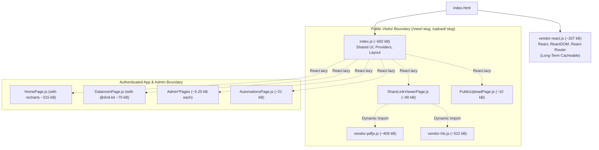

# Frontend Bundle Optimization & Code-Splitting Strategy

## Overview
This document outlines the architectural analysis, strategic decisions, and bundle-splitting patterns implemented to prevent monolithic frontend builds, reduce cold-start latency for public dataroom and document visitors, and maintain long-term caching efficiency across production deployments in ConeShare.

---

## 1. Problem Analysis & Root Cause

### 1.1 The Monolithic Entry Issue
Prior to optimization, Vite generated a single monolithic JavaScript bundle:
- `dist/assets/index-*.js`: **~2,939.78 kB uncompressed (~865.81 kB gzipped)**.
- Every public visitor accessing a shared link (e.g. `https://app.coneshare.com/view/:slug`) was forced to download the entire application bundle before the React tree could mount.

### 1.2 Module Size Breakdown
Running bundle analysis within the Docker frontend container revealed the following module distribution in the uncompressed bundle:

| Module Category | Primary Libraries | Rendered Size | Usage Context |
| :--- | :--- | :--- | :--- |
| **Application Source** | `src/pages/*`, `src/components/*` | **~1,505.72 KB** | All 30+ pages statically imported in `App.jsx` |
| **Video Streaming** | `hls.js` | **~1,275.54 KB** | HLS video playback (only needed for video documents) |
| **PDF Rendering** | `pdfjs-dist` | **~780.26 KB** | Client-side PDF rendering |
| **Charting Engine** | `recharts`, `d3-*`, `victory-vendor` | **~550.00 KB** | Analytics dashboards & Admin activity charts |
| **React Runtime** | `react-dom`, `react` | **~538.00 KB** | Core framework |
| **Date & Parsing Utilities** | `date-fns`, `dompurify`, `marked` | **~300.00 KB** | Localization, sanitization, markdown preview |
| **Drag & Drop** | `@dnd-kit/core`, `@dnd-kit/sortable` | **~60.00 KB** | Internal document & dataroom reordering |

### 1.3 Visitor Impact & Performance Bottlenecks
1. **Network Transfer Penalty**: Public visitors downloading ~866 kB of gzipped JS over cellular or high-latency networks experienced several seconds of initial blank screen.
2. **CPU Execution Block (Total Blocking Time / TBT)**: JavaScript engines (V8 / JavaScriptCore) must parse, compile, and execute 2.94 MB of code before mounting. On mobile devices, this created a 1.5–2.5 second main-thread freeze.
3. **Overfetching Waste**: Visitors browsing a public dataroom folder list never used Admin user management, automation workflows, link analytics charts, or drag-and-drop table sorters, yet 100% of those bytes were delivered upfront.

---

## 2. Architecture & Strategic Decisions



### 2.1 Strategic Choices

| Decision Area | Choice | Rationale |
| :--- | :--- | :--- |
| **Route-Level Splitting** | `React.lazy()` + `<Suspense>` in `App.jsx` | Breaks static dependency graph at the page level. Ensures admin, automation, and analytics code is never loaded on visitor routes. |
| **Component-Level Viewer Lazy Loading** | `React.lazy()` for `PdfJsViewer`, `VideoViewer`, `MarkdownViewer`, `SpreadsheetViewer` in `ShareLinkViewerPage` and `DataroomViewer` | Prevents `vendor-pdfjs` (410 kB) and `vendor-hls` (523 kB) from eagerly downloading on initial Dataroom folder/file list views before opening documents. |
| **Fallback Experience** | Global `<RouteLoadingFallback />` & Viewer `<Suspense>` | Provides smooth, non-blocking spinner transitions while lazily fetched route and viewer chunks load. |
| **Framework Chunking** | `vendor-react` via `manualChunks` | Isolates `react`, `react-dom`, and `react-router` into a standalone chunk with stable hashes across deployments for browser cache persistence. |
| **Heavy Dependency Isolation** | `vendor-pdfjs`, `vendor-hls`, `vendor-dndkit` | Isolates specialized heavy libraries so they are only requested when the relevant route or feature is loaded. |
| **Icon & UI Micro-Chunk Consolidation** | `vendor-icons` (`lucide-react`) & `vendor-ui` (`@radix-ui`) | Eliminates Rollup "Chunk Fragmentation" where 20+ separate <1KB icon chunks were generated, reducing initial HTTP requests from 29 to 13. |
| **Micro-Chunk Elimination** | `output.experimentalMinChunkSize: 10000` | Automatically absorbs sub-10KB shared UI primitives (`Input`, `Label`, `Badge`, `LanguagePicker`) into consumer chunks, cutting Dataroom cold-start requests from 13 down to 6~7 without latency penalties. |
| **Shared Utility Bleeding Prevention** | Avoid forcing shared utilities (`clsx`, `d3-*`, `es-toolkit`) into feature manual chunks | Prevents Rollup from creating circular cross-chunk dependencies that would trigger eager `<link rel="modulepreload">` tags in `index.html`. |

---

## 3. Rollup Manual Chunking Gotchas

> [!WARNING]
> **Gotcha 1: Avoid Module Bleeding into Feature Chunks**:
> When configuring `output.manualChunks(id)`, if a library like `recharts` depends on `d3-time-format` or `clsx`, and you group `d3-` into `vendor-recharts`, Rollup may place common utilities into `vendor-recharts`.
> If `index.js` also needs `clsx` or common formatting, `index.js` will statically import from `vendor-recharts`, which forces Vite to add `<link rel="modulepreload" href="vendor-recharts.js">` directly to `index.html`!
>
> **Best Practice**: Only match discrete, well-bounded top-level vendor directories (e.g., `node_modules/hls.js`, `node_modules/pdfjs-dist`, `node_modules/@dnd-kit`). Allow Rollup to naturally chunk internal feature dependencies (`recharts` inside `HomePage`) via route-level `React.lazy()`.

> [!WARNING]
> **Gotcha 2: Chunk Fragmentation from Cross-Route Shared Primitives**:
> When using `React.lazy` across multiple pages, any small dependency (such as individual icons from `lucide-react` or Radix UI components) referenced by more than one dynamic chunk will be split by Rollup into individual ~0.8KB micro-files. This causes browsers to dispatch 25–30+ HTTP requests on cold start.
>
> **Best Practice**: Explicitly consolidate frequently used design-system primitives into unified vendor chunks: `vendor-icons` for `lucide-react` and `vendor-ui` for `@radix-ui`. This collapses dozens of micro-requests into 2 cache-friendly bundles.

> [!WARNING]
> **Gotcha 3: Micro-Chunk Overhead for Sub-1KB Shared UI Primitives**:
> Even with `vendor-icons` and `vendor-ui` consolidated, internal UI components (such as `components/ui/Input.jsx`, `Label.jsx`, `Badge.jsx`, or `LanguagePicker.jsx`) shared across 2+ dynamic routes were still split into tiny 0.8KB–1.5KB files. The HTTP round-trip latency (300–700ms each) and header overhead exceeded the payload size.
>
> **Best Practice**: Set `output.experimentalMinChunkSize: 10000` in Vite's Rollup options. Rollup automatically merges any chunk under 10KB into its consumer chunk, collapsing 35 sub-10KB chunks down to 3, and reducing cold-start requests from 13 to 6~7.

---

## 4. Measured Results

All metrics were captured using the Docker frontend production build (`COMPOSE_PROJECT_NAME=coneshare docker-compose exec frontend npm run build`):

| Build Artifact / Metric | Before Optimization | Phase 1 (Route & Vendor Splitting) | Phase 2 (Micro-Chunk Merging) |
| :--- | :--- | :--- | :--- |
| **Main Entry (`index-*.js`)** | **2,939.78 kB** (865.81 kB gzip) | **692.06 kB** (217.59 kB gzip) | **611.71 kB** (191.00 kB gzip) |
| **Dataroom Cold-Start JS Requests** | **1 monolithic request** (2.94 MB) | **13 requests** (~1.1 MB) | **6~7 requests** (~1.0 MB) |
| **Total Chunks Generated** | 1 chunk | 67 chunks (35 under 10KB) | 38 chunks (only 3 under 10KB) |
| **React Runtime (`vendor-react-*.js`)** | Bundled in main | **337.57 kB** (106.45 kB gzip) | **337.57 kB** (106.45 kB gzip) |
| **Chart Engine (`recharts`)** | Bundled in main | **315.53 kB** (lazy chunk) | **315.11 kB** (lazy chunk) |
| **Drag & Drop (`@dnd-kit`)** | Bundled in main | Lazy chunk | Lazy chunk (0 kB for visitors) |
| **Total Test Suite Stability** | 61 files (487 tests passed) | 61 files (487 tests passed) | **61 files (487 tests passed, 100%)** |

---

## 5. Development & Verification Guide

### 5.1 Verification Commands (Docker Environment)

```bash
# 1. Run production build and verify chunk sizes
COMPOSE_PROJECT_NAME=coneshare docker-compose exec frontend npm run build

# 2. Inspect generated assets and distribution
ls -lh frontend/dist/assets/

# 3. Execute frontend test suite
COMPOSE_PROJECT_NAME=coneshare docker-compose exec frontend npm run test:whitelist
```

### 5.2 Browser Network Inspection
1. Open Chrome DevTools (`F12`), navigate to **Network**, and enable **Disable cache**.
2. Filter by **JS** and load a public dataroom URL (`/view/:slug`).
3. Verify that `index-*.js` and `vendor-react-*.js` are loaded.
4. Filter/search for `recharts` or `Admin`: verify that **zero** requests are dispatched.
