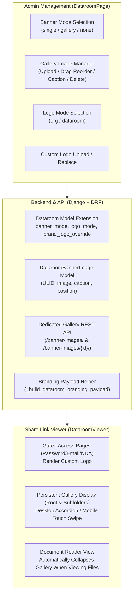
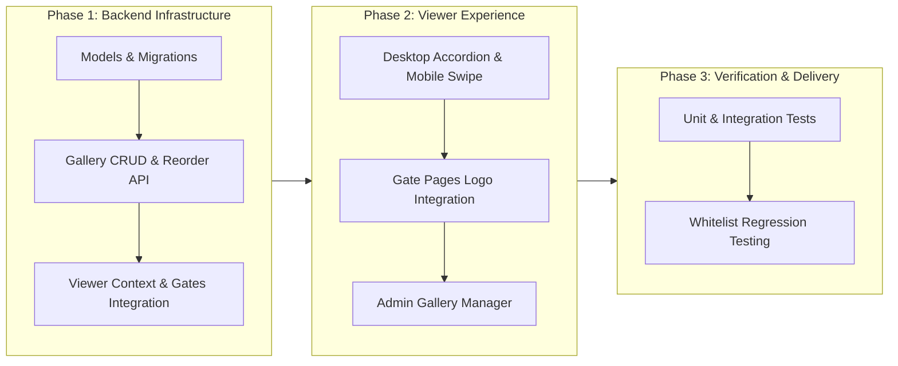

# 🏢 Dataroom Banner Gallery and Custom Logo Override PRD

> **Document Status**: Implemented  
> **Domain**: Datarooms / White-labeling  
> **Related Files**:  
> - Backend Models: [models.py](backend/datarooms/models.py)  
> - Share Link Viewer: [DataroomViewer.jsx](frontend/src/components/viewer/DataroomViewer.jsx)  
> - Header & Gates: [DocumentViewerHeader.jsx](frontend/src/components/viewer/DocumentViewerHeader.jsx), [PasswordForm.jsx](frontend/src/components/viewer/PasswordForm.jsx), [EmailForm.jsx](frontend/src/components/viewer/EmailForm.jsx), [NDAForm.jsx](frontend/src/components/viewer/NDAForm.jsx)  
> - Dataroom Settings: [DataroomPage.jsx](frontend/src/pages/DataroomPage.jsx)  

---

## 1. Background & Product Goals

### 1.1 Background
Currently, ConeShare Virtual Datarooms (VDR) support uploading a single static banner (`branding_banner`) and falling back to the organization's unified brand logo. However, in high-value commercial scenarios, a single branding setup does not meet customer needs:
1. **Multi-Project Independent Operations / Multi-Brand Groups**: Different datarooms within the same organization represent separate projects, investment targets, or asset packages. They require project-specific branding and dedicated logos rather than the parent organization's global identity.
2. **High-Impact Visual Asset Showcase**: During private equity financing, M&A, tech ventures, and physical asset pitches, a single static banner has limited storytelling capacity. Dealmakers want a **Banner Gallery** to showcase project sites, factory facilities, product matrices, or leadership teams.

### 1.2 Product Goals
- **Enhance White-label Branding**: Support per-dataroom custom logo overrides (fallback to organization logo or override with a dedicated dataroom logo), effective throughout the entire viewer journey.
- **Elevate Visual Showcase Experience**: Introduce an **Accordion Gallery** mode featuring smooth desktop hover expansion and mobile touch-swipe interactions.
- **Ensure Lightweight Operations & Security**: Provide drag-and-drop reordering, instant caption editing, and isolated branding storage quotas that do not consume business document quotas.

---

## 2. Core Architecture & Workflow



---

## 3. Detailed Functional Specifications

### 3.1 Banner Gallery (`banner_mode`)

#### 3.1.1 Mode Definitions
- **`single` (Single Image, Default)**: Preserves existing behavior, rendering a single static banner.
- **`gallery` (Gallery Mode)**: Enables an interactive multi-image gallery.
- **`none` (No Banner)**: Hides banners to maximize vertical screen space for document browsing.

#### 3.1.2 Viewer Rendering & Interaction
1. **Desktop**:
   - **Interaction**: Immersive **Accordion Gallery**.
   - **Visual Standards**:
     - **Root Directory Height**: Responsive height `clamp(320px, 40vh, 460px)` with horizontal side-by-side alignment.
     - **Subfolder Compact Optimization**: Compact height `clamp(180px, 25vh, 260px)` in subfolders to preserve vertical screen space for deep document hierarchies.
     - Default state activates the first or center image (expanded to ~50%-60% width) while remaining items contract evenly.
     - Mouse hover smoothly expands the hovered card (`transition-all duration-300 ease-out`).
     - A semi-transparent gradient overlay at the bottom cleanly displays the image caption.
2. **Mobile / Tablet**:
   - **Interaction**: Gracefully falls back to a **Touch Swipe Carousel**.
   - **Visual Standards**:
     - Native horizontal scroll (`overflow-x-auto snap-x snap-mandatory`) for fluid scrolling without heavy carousel dependencies.
     - Centered semi-transparent pagination dots at the bottom.
     - Each card spans 85%~90% of screen width, peeking the adjacent card edge as an intuitive swipe cue.
3. **Display Hierarchy**:
   - **Persistent in Directories**: The gallery stays visible across the root folder and all subfolders to maintain brand presence.
   - **Auto-Collapse in Document Reader**: Automatically hidden when a visitor views an individual document (PDF, Markdown, Spreadsheet, Video, etc.) to ensure reading focus.

#### 3.1.3 Edge Cases & Fallbacks
- **0 Images**: If `gallery` mode is enabled but no images are uploaded, the viewer treats it as `none` mode, preventing broken or empty space.
- **1 Image**: If only 1 image exists, the viewer renders it as a full-width static banner to prevent single-slice distortion.

---

### 3.2 Custom Logo Override (`logo_mode`)

#### 3.2.1 Mode Definitions
- **`org` (Organization Default, Default)**: Falls back to the organization's global logo.
- **`dataroom` (Dataroom Logo)**: Uses the dedicated logo uploaded specifically for this dataroom.

#### 3.2.2 Lifecycle & Scope
The custom logo override applies across the **entire viewer lifecycle**:
1. **Gated Access Pages**:
   - Password prompt ([`PasswordForm`](frontend/src/components/viewer/PasswordForm.jsx))
   - Email gate ([`EmailForm`](frontend/src/components/viewer/EmailForm.jsx))
   - NDA agreement ([`NDAForm`](frontend/src/components/viewer/NDAForm.jsx))
2. **Dataroom Directory & Document Viewer**:
   - Top navigation header ([`DocumentViewerHeader`](frontend/src/components/viewer/DocumentViewerHeader.jsx))
   - Document previews opened directly within the dataroom.

> **Implementation Notes**:
> 1. The public share link metadata endpoint (`GET /api/v1/links/:slug/public-meta/`) returns computed branding fields (`logo_mode`, `resolved_brand_logo_url`), allowing gate pages to render the correct logo immediately without extra API roundtrips.
> 2. Standalone file links (`link.dataroom is None`) retain `logo_mode = 'org'` and use the organization's global logo.

---

### 3.3 Admin Configuration Panel (`DataroomPage.jsx`)

Under the **Branding Settings** section in Dataroom settings:

1. **Logo Mode Controls**:
   - Radio buttons: `[Organization Default] [Dataroom Logo]`.
   - Selecting "Dataroom Logo" reveals the upload card supporting drag-and-drop upload, preview, replacement, and removal.
2. **Banner Mode Controls**:
   - Radio buttons: `[Single Banner] [Banner Gallery] [No Banner]`.
   - Selecting "Single Banner" displays the single banner upload and removal UI.
3. **Banner Gallery Manager**:
   - **Grid Display**: Responsive thumbnail grid (2 to 4 columns).
   - **Capacity**: Maximum of **10 images** per dataroom; the upload button is disabled when the limit is reached.
   - **Reordering**: Drag-and-drop reordering that triggers the batch reorder API upon drop.
   - **Caption Editing**: Inline editing allows updating captions in place.
   - **Deletion**: Hover delete button with confirmation tooltip and automatic re-indexing.

---

## 4. Storage Quotas & Security Standards

1. **Quota Policy**:
   - **Isolated Branding Quota**: Logos and gallery banners are cosmetic presentation assets and **do not consume** the dataroom's document storage quota (`storage_quota_mb`), preventing branding updates from blocking business document uploads.
   - **File Size Limits**:
     - Gallery images: Maximum **5 MB** each.
     - Custom logos: Maximum **2 MB** each.
2. **Format & Verification**:
   - **Allowed Formats**: Strictly restricted to raster formats (`PNG`, `JPG`, `JPEG`, `WEBP`).
   - **Content Verification**: The backend validates image binary headers using Pillow (`Image.open(value).verify()`), completely eliminating SVG-based Stored XSS attack vectors.
   - **Isolated Storage Paths**:
     - Custom logos: `dataroom-branding/{org_id}/{dataroom_id}/logo{ext}`
     - Gallery images: `dataroom-branding/{org_id}/{dataroom_id}/gallery/{ulid}{ext}`

---

## 5. Backend Data Models & API Specifications

### 5.1 Data Models

#### 5.1.1 `Dataroom` Model (`backend/datarooms/models.py`)
```python
from django.core.validators import FileExtensionValidator

BANNER_MODE_CHOICES = (
    ('single', 'Single banner image'),
    ('gallery', 'Banner gallery'),
    ('none', 'No banner'),
)

LOGO_MODE_CHOICES = (
    ('org', 'Organization logo (fallback)'),
    ('dataroom', 'Dataroom logo'),
)

class Dataroom(BaseModel):
    # ... existing fields ...
    banner_mode = models.CharField(
        max_length=16,
        choices=BANNER_MODE_CHOICES,
        default='single',
        help_text="Banner surface rendering mode"
    )
    brand_logo_override = models.FileField(
        upload_to=dataroom_branding_logo_path,
        null=True,
        blank=True,
        validators=[FileExtensionValidator(allowed_extensions=['png', 'jpg', 'jpeg', 'webp'])],
        help_text="Optional per-dataroom logo (supports PNG, JPG, WebP)"
    )
    logo_mode = models.CharField(
        max_length=16,
        choices=LOGO_MODE_CHOICES,
        default='org',
        help_text="Logo surface rendering mode"
    )
```

#### 5.1.2 `DataroomBannerImage` Model (`backend/datarooms/models.py`)
```python
class DataroomBannerImage(BaseModel):
    dataroom = models.ForeignKey(Dataroom, on_delete=models.CASCADE, related_name='banner_images')
    image = models.ImageField(upload_to=dataroom_gallery_image_path)
    caption = models.CharField(max_length=255, blank=True, default="")
    position = models.PositiveIntegerField(default=0, db_index=True)

    class Meta:
        ordering = ['position', 'created_at']
        indexes = [
            models.Index(fields=['dataroom', 'position']),
        ]

    def __str__(self):
        return f"{self.dataroom_id} banner image #{self.position}"
```

---

### 5.2 API Endpoints

| Method | Endpoint | Permissions | Description |
| :--- | :--- | :--- | :--- |
| `GET` | `/api/v1/datarooms/{id}/banner-images/` | Owner / Admin / Collaborator | List all banner images for the dataroom |
| `POST` | `/api/v1/datarooms/{id}/banner-images/` | Owner / Admin | Upload a new banner image (`image`, `caption`, `position`; max 10 images) with atomic concurrency lock |
| `PATCH` | `/api/v1/datarooms/{id}/banner-images/{banner_id}/` | Owner / Admin | Update image caption or position |
| `DELETE` | `/api/v1/datarooms/{id}/banner-images/{banner_id}/` | Owner / Admin | Delete a banner image and remove underlying file storage |
| `POST` | `/api/v1/datarooms/{id}/banner-images/reorder/` | Owner / Admin | **Batch atomic reorder API**, accepts `[{"id": "...", "position": 0}, ...]` (validating unique IDs and positions) |
| `PATCH` | `/api/v1/datarooms/{id}/` | Owner / Admin | Update dataroom settings (`banner_mode`, `logo_mode`, `brand_logo_override`, `remove_brand_logo_override`) |
| `GET` | `/api/v1/links/{slug}/public-meta/` | Public | Share link metadata, returns `logo_mode`, `resolved_brand_logo_url` |
| `GET` | `/api/v1/links/{slug}/view-data/` | Public (Gate Protected) | Dataroom viewer payload, returns `banner_mode`, `banner_images`, `logo_mode`, `brand_logo_override` |

---

## 6. Implementation Milestones



### Phase 1: Backend Data Layer & APIs
1. Model updates (`banner_mode`, `logo_mode`, `brand_logo_override`) and Django migrations.
2. `DataroomBannerImageSerializer`, file size verification, and Pillow raster image content validation.
3. ViewSet actions: `banner_images`, `banner_image_detail`, and atomic `reorder` with duplicate rejection.
4. Extracted `_build_dataroom_branding_payload` and integrated with `_build_share_link_public_meta`.

### Phase 2: Viewer Presentation
1. Desktop `AccordionGallery` component with smooth transitions and height adaptation.
2. Mobile touch-swipe carousel `MobileSwipeGallery`.
3. Integrated persistent gallery in `DataroomViewer` (auto-collapsed during single document view, hidden if 0 images, single-banner if 1 image).
4. Connected dynamic logo override to `PasswordForm`, `EmailForm`, `NDAForm`, and `DocumentViewerHeader`.

### Phase 3: Admin Configuration Panel
1. Mode selector radio buttons in `DataroomPage`.
2. Thumbnail grid cards, drag-and-drop reordering, delete confirmation, and caption editing.
3. Connected frontend API Client (`frontend/src/services/api.js`).

### Phase 4: Testing & Quality Assurance
1. **Backend Tests**: Model validation, reorder calculations, permission enforcement, 10-image limit, raster validation, and corrupt/SVG rejection.
2. **Frontend Tests**: `AccordionGallery.test.jsx`, gate form logo overrides, and `DataroomPage` upload/reorder test suites.
3. **Test Whitelist**: Added new tests to `vitest.whitelist.json`, ensuring 100% pass rate.
