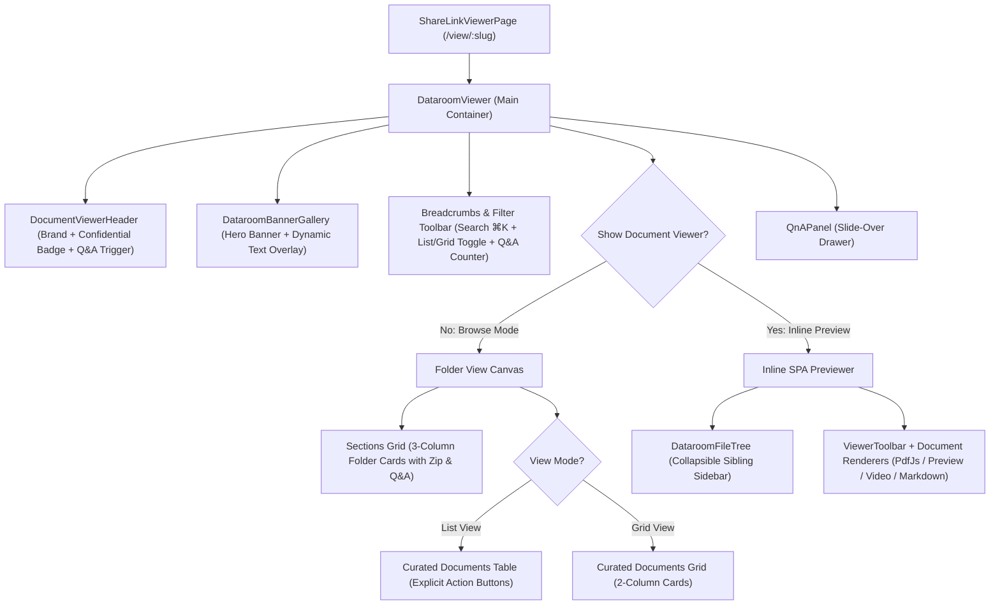

# Dataroom List Viewer Redesign Blueprint (Stitch Mockup Alignment)

This blueprint outlines the technical implementation plan to align Coneshare's public **Dataroom Viewer** (`DataroomViewer.jsx`) with the design mockup in Stitch (**Screen 4: Acme Enterprise Dataroom - Customer View**).

---

## 1. Executive Summary & Design Decisions

Through the `/grill-me` alignment, the following architectural choices were agreed upon:

| Decision Area | Chosen Approach | Rationale |
|---|---|---|
| **Scope of Adaptation** | **Pure Frontend Enhancement** | Avoids backend schema migrations and preserving existing API stability. |
| **Folder Sections Grid** | **Hierarchical Drill-Down** | Clicking a folder card updates `parent_id` and breadcrumbs. Automatically hides the grid when a subfolder contains no further subfolders. |
| **Header & Navigation** | **Enhanced Identity Header** | Retains active brand logo, name, language picker, and Q&A trigger; appends dynamic `🔒 Confidential · Watermarked` badge. Omits hardcoded dead-link tabs. |
| **Hero Banner** | **Dynamic Metadata Overlay** | Overlays Dataroom name, relative update time, and real-time security pills (NDA, Watermarking, Expiration) on the banner. |
| **Row & Card Actions** | **Explicit Desktop Actions** | Prominent `View Document` button alongside quick Q&A and Download icon buttons; collapses gracefully on mobile. |
| **Document Previewer** | **Inline SPA Preservation** | Keeps Coneshare's in-page reader with `DataroomFileTree` and `ViewerToolbar`, modernizing typography and watermark presentation. |

---

## 2. Component Architecture & Data Flow

---

## 3. Phased Implementation Roadmap

### Phase 1: Header & Hero Banner Upgrades ✅ [Completed]
- **File**: [`frontend/src/components/viewer/DocumentViewerHeader.jsx`](../../frontend/src/components/viewer/DocumentViewerHeader.jsx)
  - Security status capsule: `🔒 Confidential · Watermarked` (rendered dynamically when watermark is active).
  - Visitor session pill: `Visitor Mode · Tracked`.
- **File**: [`frontend/src/components/viewer/DataroomBannerGallery.jsx`](../../frontend/src/components/viewer/DataroomBannerGallery.jsx)
  - Bottom gradient scrim overlay displaying room name, relative update time (`updated_at`), and security tags (*Confidential · NDA Active*).
  - Rounded-2xl card presentation matching centered canvas container.

### Phase 2: Navigation & Search Toolbar ✅ [Completed]
- **File**: [`frontend/src/components/viewer/DataroomViewer.jsx`](../../frontend/src/components/viewer/DataroomViewer.jsx)
  - Unified Breadcrumbs & Controls card (`bg-white rounded-xl border border-gray-200/80 p-3 sm:p-4 shadow-2xs`) combining:
    - Left: Breadcrumb trail with root home button and resource count badge.
    - Right: Client-side search input (`Filter files in this folder... ⌘K`), View Mode switcher (`list` vs `grid` with `localStorage` persistence), and Folder Q&A button.

### Phase 3: Folders Grid (Folder Cards) ✅ [Completed]
- **File**: [`frontend/src/components/viewer/DataroomFolderGrid.jsx`](../../frontend/src/components/viewer/DataroomFolderGrid.jsx)
  - Renamed all occurrences of "SECTION / Sections" to "FOLDER / Folders" per user request.
  - 3-column responsive card grid with index numbers (`01`, `02`), folder icons, title hover transitions, and direct action icons (Folder Q&A, Folder ZIP download).
  - Expandable controls: Top toggle and bottom pill (`Show all X folders` / `Show X more folders`).

### Phase 4: Document List & Grid View Components ✅ [Completed]
- **File**: [`frontend/src/components/viewer/DataroomDocumentCard.jsx`](../../frontend/src/components/viewer/DataroomDocumentCard.jsx)
  - 2-column Grid View card with index badge (`#01`), file type badge, name, metadata, quick Q&A/Download, and prominent `View Document` / `Watch Video` CTA.
- **File**: [`frontend/src/components/viewer/DataroomViewer.jsx`](../../frontend/src/components/viewer/DataroomViewer.jsx)
  - Upgraded List View `ListItem` to modern horizontal card rows matching Stitch Screen 4 (`<article className="... rounded-xl bg-white border border-gray-200/80 ...">`).
  - Centered browse canvas inside `<main className="flex-1 overflow-y-auto bg-gray-50/60 py-6">
`.

### Phase 5: Inline Document Previewer Polish ✅ [Completed]
- Aligned [`ViewerToolbar.jsx`](../../frontend/src/components/viewer/ViewerToolbar.jsx) styling.
- Watermark overlay updated to uniform -25° angled repetition across `PdfJsViewer.jsx`, `MarkdownViewer.jsx`, and `SpreadsheetViewer.jsx`.

---

## 4. Test Strategy

1. **Unit & Component Tests**:
   - `DataroomViewer.test.jsx`:
     - Test partitioning of items into folder cards vs document list/grid.
     - Test list/grid view toggle state persistence.
     - Test client-side filter input matching by filename.
     - Test clicking folder cards triggers `parent_id` search param update.
     - Test clicking `View Document` sets `dataroom_document_id`.
   - Whitelist registration: Add any new test files to [`frontend/vitest.whitelist.json`](../../frontend/vitest.whitelist.json).
2. **Manual & Responsive Verification**:
   - Test on desktop (2560px and 1440px) and mobile viewports (<640px).
   - Verify folder ZIP download and Q&A drawer context switching.
